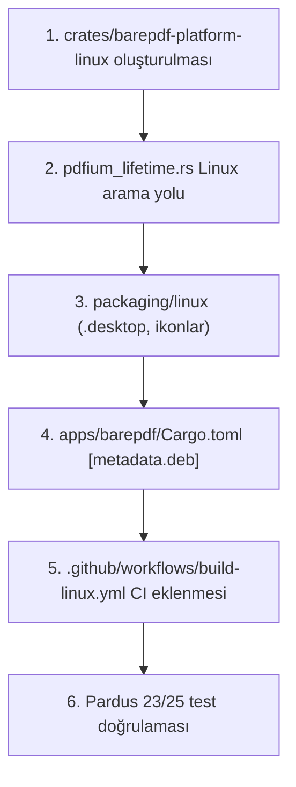

# BarePDF Linux & Pardus Dağıtım ve Entegrasyon Planı

> **Talimat:** Bu plan dosyası, gelecekteki herhangi bir AI ajanı veya geliştirici tarafından ek bir bağlama veya açıklamaya ihtiyaç duyulmadan baştan sona doğrudan uygulanabilir şekilde hazırlanmıştır. Başlamadan önce [Bölüm 13'teki Ajan Yönergelerini](#13-bu-planı-uygulayacak-ajana-talimatlar) okuyunuz.

---

## 1. Amaç, Kapsam ve Alınan Kararlar

### 1.1. Amaç
BarePDF masaüstü PDF görüntüleyicisini Linux platformuna, birincil öncelikle **Pardus 23 "Yirmiüç"** (Debian 12 Bookworm tabanlı) ve **Pardus 25 "Bilge"** (Debian 13 Trixie tabanlı) işletim sistemlerine taşımak; sıfır ek bakım yükü ile otomatik dağıtım sağlamak.

### 1.2. Kapsam
- **Birincil Format:** Debian/Pardus için `.deb` paketi (`barepdf_<version>_amd64.deb`).
- **İkincil Format:** Kurulumsuz taşınabilir çalıştırma için `AppImage` (`BarePDF-<version>-x86_64.AppImage`).
- Linux platform soyutlama katmanı (`crates/barepdf-platform-linux`).
- GitHub Actions CI/CD Linux derleme ve otomatik paketleme hattı.
- Masaüstü entegrasyonu (MIME `application/pdf`, `.desktop`, ikonlar).
- Güvenli Linux updater politikası (paket yöneticisi çakışmasını engelleyen salt-bildirim modu).

### 1.3. Kapsam Dışı
- Pardus resmi depolarına (TÜBİTAK ULAKBİM) paket başvuru süreci (ilk aşamada GitHub Releases üzerinden doğrudan `.deb` dağıtımı esastır).
- Flathub / Flatpak manifestosu (katı sandbox ve bağımsız depo yükü nedeniyle ilk aşamada kapsam dışıdır).
- ARM64 / RISC-V mimarileri (ilk aşamada x86_64 hedeflenmektedir).

### 1.4. Alınan Kararlar ve Gerekçeleri
1. **Format Tercihi (Seçenek 1):** `.deb` ana format, `AppImage` ikincil formattır. Pardus kullanıcıları indirdikleri `.deb` paketine çift tıklayarak yerleşik "Pardus Paket Kurucu" ile anında kurulum yapabilmektedir.
2. **Derleme Ortamı (glibc Tabanı):** CI işi `ubuntu-22.04` (glibc 2.35) üzerinde çalıştırılacaktır. Bu sayede üretilen binary, Pardus 23'ün glibc 2.36'sı ve Pardus 25'in glibc 2.41'i ile geriye dönük tam uyumlu çalışır; glibc sembol hatası vermez.
3. **Tek Sürüm Sözleşmesi:** Sürüm numarası kök `Cargo.toml` (`[workspace.package].version`) dosyasından miras alınır; Linux paket metaverileri buradaki tek kaynaktan beslenir.
4. **Updater Davranışı:** Linux'ta sistem genelinde (`/usr/bin/`) kurulu BarePDF, kök yetkisi (`root/sudo`) istememek ve paket yöneticisiyle çakışmamak için dosyaları yerinde güncellemez; sadece güncelleme olduğunu bildirir ve release sayfasına yönlendirir.

---

## 2. Mevcut Durum Envanteri

- **Rust Sürümü:** 1.92+ (Edition 2021)
- **UI Kütüphanesi:** Slint 1.9 (`backend-winit`, `renderer-femtovg`, `accessibility`)
- **PDF Motoru:** Google Pdfium (`pdfium-render 0.9` thread-safe)
- **Mevcut Çalışma Alanı (Crates):**
  - `crates/barepdf-core`: Temel modeller, tercihler (`UserPreferences`).
  - `crates/barepdf-pdf`: Pdfium yükleyici ve belge motoru.
  - `crates/barepdf-render`: Asenkron çizelgeleyici ve bitmap önbelleği.
  - `crates/barepdf-platform`: Platform soyutlama trait'leri (`PlatformError`, `FileWatcher`, `PrinterSink`).
  - `crates/barepdf-platform-windows`: Windows'a özel Win32 API uygulamaları.
  - `crates/barepdf-i18n`: Yerelleştirme motoru (TR/EN).
  - `crates/barepdf-ui`: Slint penceresi ve bileşenleri.
  - `apps/barepdf`: Ana uygulama binary'si.

---

## 3. Adım Adım Uygulama Listesi

### Adım 1: Linux Platform Sandığı (`crates/barepdf-platform-linux`) Oluşturulması
Mevcut `crates/barepdf-platform` trait'lerini uygulayan Linux platform crate'i oluşturulur.

#### 1.1. `crates/barepdf-platform-linux/Cargo.toml`
```toml
[package]
name = "barepdf-platform-linux"
version.workspace = true
edition.workspace = true
rust-version.workspace = true
authors.workspace = true
license.workspace = true
repository.workspace = true
description = "Linux platform implementation for BarePDF"

[dependencies]
barepdf-platform = { path = "../barepdf-platform" }
arboard = { workspace = true }
rfd = { workspace = true }
tracing.workspace = true

[lints]
workspace = true
```

#### 1.2. `crates/barepdf-platform-linux/src/lib.rs`
```rust
#![forbid(unsafe_code)]

mod clipboard;
mod dialogs;
mod shell;

pub use clipboard::LinuxClipboard;
pub use dialogs::{ask_yes_no, show_fatal_error, LinuxFileDialogs};
pub use shell::open_url;
```

#### 1.3. `crates/barepdf-platform-linux/src/shell.rs`
```rust
use std::process::Command;

pub fn open_url(url: &str) -> bool {
    Command::new("xdg-open")
        .arg(url)
        .spawn()
        .map(|_| true)
        .unwrap_or(false)
}
```

#### 1.4. `crates/barepdf-platform-linux/src/dialogs.rs`
```rust
use std::path::PathBuf;

#[derive(Debug, Default, Clone, Copy)]
pub struct LinuxFileDialogs;

impl LinuxFileDialogs {
    #[must_use]
    pub fn pick_file(&self) -> Option<PathBuf> {
        rfd::FileDialog::new()
            .add_filter("PDF Document", &["pdf"])
            .pick_file()
    }

    #[must_use]
    pub fn save_file(&self, default_name: &str) -> Option<PathBuf> {
        rfd::FileDialog::new()
            .set_file_name(default_name)
            .add_filter("PDF Document", &["pdf"])
            .save_file()
    }
}

pub fn ask_yes_no(title: &str, message: &str) -> bool {
    rfd::MessageDialog::new()
        .set_title(title)
        .set_description(message)
        .set_buttons(rfd::MessageButtons::YesNo)
        .show() == rfd::MessageDialogResult::Yes
}

pub fn show_fatal_error(title: &str, message: &str) {
    rfd::MessageDialog::new()
        .set_title(title)
        .set_description(message)
        .set_level(rfd::MessageLevel::Error)
        .show();
}
```

#### 1.5. `crates/barepdf-platform-linux/src/clipboard.rs`
```rust
use arboard::Clipboard;
use std::sync::Mutex;

pub struct LinuxClipboard {
    inner: Mutex<Option<Clipboard>>,
}

impl LinuxClipboard {
    #[must_use]
    pub fn new() -> Self {
        Self {
            inner: Mutex::new(Clipboard::new().ok()),
        }
    }

    pub fn set_text(&self, text: &str) -> bool {
        let mut guard = self.inner.lock().unwrap_or_else(|e| e.into_inner());
        if guard.is_none() {
            *guard = Clipboard::new().ok();
        }
        guard.as_mut().and_then(|c| c.set_text(text).ok()).is_some()
    }
}

impl Default for LinuxClipboard {
    fn default() -> Self {
        Self::new()
    }
}
```

#### 1.6. Çalışma Alanı (`Cargo.toml`) Güncellemesi
Kök `Cargo.toml` dosyasında `members` listesine `"crates/barepdf-platform-linux"` eklenir. `apps/barepdf/Cargo.toml` içine hedef tabanlı bağımlılık tanımlanır:
```toml
[target.'cfg(target_os = "linux")'.dependencies]
barepdf-platform-linux = { path = "../../crates/barepdf-platform-linux" }
```

---

### Adım 2: Linux Pdfium (`libpdfium.so`) Çözümlemesi
`crates/barepdf-pdf/src/pdfium_lifetime.rs` dosyasında, çalıştırılabilir dosyanın kardeş dizini ve `/usr/lib/barepdf/` Linux kütüphane arama yoluna dahil edilir:

```rust
#[cfg(target_os = "linux")]
fn resolve_linux_library_path() -> Option<PathBuf> {
    // 1. Kardeş dizin ($ORIGIN)
    if let Ok(exe_path) = std::env::current_exe() {
        if let Some(parent) = exe_path.parent() {
            let candidate = parent.join("libpdfium.so");
            if candidate.is_file() {
                return Some(candidate);
            }
        }
    }
    // 2. Sistem /usr/lib/barepdf/ dizini (.deb paketi konumu)
    let system_lib = PathBuf::from("/usr/lib/barepdf/libpdfium.so");
    if system_lib.is_file() {
        return Some(system_lib);
    }
    None
}
```

---

### Adım 3: Linux Masaüstü Entegrasyon Dosyaları

#### 3.1. Masaüstü Kısayolu: `packaging/linux/barepdf.desktop`
```ini
[Desktop Entry]
Type=Application
Name=BarePDF
GenericName=PDF Viewer
GenericName[tr]=PDF Görüntüleyici
Comment=Bare, Fast, Yours. Ultra-lightweight PDF reader
Comment[tr]=Yalın, hızlı ve hafif PDF görüntüleyici
Exec=barepdf %U
Icon=barepdf
Terminal=false
Categories=Office;Viewer;Graphics;
MimeType=application/pdf;application/x-pdf;
Keywords=PDF;Reader;Viewer;Office;Pardus;
StartupWMClass=barepdf
```

#### 3.2. İkon Dosyaları: `packaging/linux/icons/`
`assets/` dizinindeki mevcut BarePDF uygulama simgesi SVG ve PNG (48x48, 128x128, 256x256) olarak hazırlanıp `packaging/linux/icons/` dizinine yerleştirilir.

#### 3.3. `cargo-deb` Yapılandırması (`apps/barepdf/Cargo.toml`)
`apps/barepdf/Cargo.toml` sonuna şu metadata eklenir:
```toml
[package.metadata.deb]
name = "barepdf"
maintainer = "BarePDF Contributors <contact@barepdf.app>"
copyright = "2026, BarePDF Contributors"
license-file = ["../../LICENSE", "4"]
depends = "$auto, libxkbcommon0, libfontconfig1, libgbm1, xdg-utils"
section = "graphics"
priority = "optional"
assets = [
    ["target/release/barepdf", "usr/bin/barepdf", "755"],
    ["target/release/libpdfium.so", "usr/lib/barepdf/libpdfium.so", "644"],
    ["../../packaging/linux/barepdf.desktop", "usr/share/applications/barepdf.desktop", "644"],
    ["../../packaging/linux/icons/barepdf.svg", "usr/share/icons/hicolor/scalable/apps/barepdf.svg", "644"],
]
```

---

## 4. CI/CD Değişiklikleri (GitHub Actions)

`.github/workflows/release.yml` veya yeni `.github/workflows/build-linux.yml` workflow'u:

```yaml
name: Linux Build & Package

on:
  push:
    tags:
      - 'v*'
  workflow_dispatch:

jobs:
  build-linux:
    name: Build Pardus / Linux (.deb & AppImage)
    runs-on: ubuntu-22.04  # Pardus 23 (glibc 2.36) ve 25 ile tam uyum için glibc 2.35 tabanı
    steps:
      - name: Checkout repository
        uses: actions/checkout@v4

      - name: Install Rust toolchain
        uses: dtolnay/rust-toolchain@stable
        with:
          toolchain: 1.92.0

      - name: Install System Dependencies
        run: |
          sudo apt-get update
          sudo apt-get install -y libfontconfig1-dev libxkbcommon-dev libgl1-mesa-dev libgbm-dev

      - name: Install cargo-deb
        run: cargo install cargo-deb --locked

      - name: Download Pinned Pdfium Linux Binary
        run: |
          curl -sSL -o pdfium-linux-x64.tgz https://github.com/bblanchon/pdfium-binaries/releases/download/chromium%2F6895/pdfium-linux-x64.tgz
          tar -xzf pdfium-linux-x64.tgz lib/libpdfium.so
          mkdir -p target/release
          mv lib/libpdfium.so target/release/

      - name: Build BarePDF Release
        run: cargo build --release --locked --package barepdf

      - name: Build Debian/Pardus Package (.deb)
        run: cargo deb --package barepdf --no-build

      - name: Generate AppImage
        run: |
          curl -sSL -o appimagetool https://github.com/AppImage/AppImageKit/releases/download/continuous/appimagetool-x86_64.AppImage
          chmod +x appimagetool
          mkdir -p AppDir/usr/bin AppDir/usr/lib AppDir/usr/share/applications AppDir/usr/share/icons/hicolor/scalable/apps
          cp target/release/barepdf AppDir/usr/bin/
          cp target/release/libpdfium.so AppDir/usr/lib/
          cp packaging/linux/barepdf.desktop AppDir/
          cp packaging/linux/icons/barepdf.svg AppDir/usr/share/icons/hicolor/scalable/apps/
          cp packaging/linux/icons/barepdf.svg AppDir/barepdf.svg
          echo '#!/bin/sh' > AppDir/AppRun
          echo 'HERE="$(dirname "$(readlink -f "${0}")")"' >> AppDir/AppRun
          echo 'export LD_LIBRARY_PATH="${HERE}/usr/lib:${LD_LIBRARY_PATH}"' >> AppDir/AppRun
          echo 'exec "${HERE}/usr/bin/barepdf" "$@"' >> AppDir/AppRun
          chmod +x AppDir/AppRun
          ./appimagetool AppDir BarePDF-x86_64.AppImage

      - name: Upload Artifacts
        uses: actions/upload-artifact@v4
        with:
          name: linux-packages
          path: |
            target/debian/*.deb
            *.AppImage
```

---

## 5. Linux Updater Stratejisi

1. **Çakışma Koruması:**
   Linux ortamında çalışırken `apps/barepdf/src/presentation/update_ui.rs` dosyasında güncelleme indirme/kurma aksiyonu yerine release sayfası linki gösterilir:
   ```rust
   #[cfg(target_os = "linux")]
   pub(crate) fn handle_linux_update_action(version: &str) {
       let release_url = format!("https://github.com/Woffluon/BarePDF/releases/tag/v{version}");
       barepdf_platform_linux::open_url(&release_url);
   }
   ```
2. **Kök Yetkisi İstememe:** Uygulama asla `pkexec` veya `sudo` çağrısı yapmaz. Sistem paketi güncellemeleri sistem yöneticisinin veya kullanıcının `apt` / "Pardus Paket Kurucu" tercihindedir.

---

## 6. Yerelleştirme ve Pardus Türkçe Desteği

- Pardus varsayılan masaüstü dili Türkçedir (`LANG=tr_TR.UTF-8`).
- `barepdf-i18n` sistem dili çözümleyicisi (`Language::System.resolve()`), `std::env::var("LANG")` veya `LC_MESSAGES` değişkenlerini okuyarak ilk açılışta otomatik olarak Türkçe arayüzü seçer.
- ASCII protokol karşılaştırmalarında Türkçedeki noktalı `İ` / `ı` harf karışıklığını önlemek için `to_ascii_lowercase()` kullanılır.

---

## 7. Test Planı ve Pardus Doğrulama Kontrol Listesi

### Otomatik Testler
- [ ] `cargo check --target x86_64-unknown-linux-gnu` derleme testi
- [ ] `cargo test --workspace` birim testleri (Linux sanal ortamında)
- [ ] `cargo deb` paketleme bütünlük testi (lintian kontrolleri)

### Pardus 23 & 25 Manuel Doğrulama (Checkbox'lı)
- [ ] **Temiz Kurulum:** `.deb` paketi Pardus Paket Kurucu ile hatasız kuruluyor mu?
- [ ] **Masaüstü Menüsü:** "Uygulamalar -> Ofis -> BarePDF" altında simgesiyle görünüyor mu?
- [ ] **Varsayılan Uygulama:** Bir PDF dosyasına sağ tıklayıp "BarePDF ile Aç" seçildiğinde belge açılıyor mu?
- [ ] **G1 - Maximize Açılış:** İlk açılışta pencere kenarlıklı/başlıklı maximize açılıyor mu?
- [ ] **G2 - Sol Panel:** Farklı PDF belgelerinde sayfa önizlemeleri sağ/sol beyaz boşluk olmadan tam oturuyor mu?
- [ ] **G3 - Yerelleştirme:** Sistem dili Türkçe iken tüm arayüz, menüler ve ipuçları Türkçe mi?
- [ ] **G5 - Pan Aracı:** Araç çubuğunda el ikonu net görünüyor ve tıklanınca belge kaydırma çalışıyor mu?
- [ ] **G4 - Güncelleyici:** Yeni sürüm çıktığında sistem dosyalarını bozmadan release linkine yönlendiriyor mu?
- [ ] **Kaldırma:** Paket Pardus Paket Kurucu veya `apt remove barepdf` ile artık dosya bırakmadan kaldırılabiliyor mu?

---

## 8. Bakım Yükü ve Minimumda Tutma Kuralları

- **Sıfır Ek Kod Tekrarı:** Linux'a özel UI veya PDF işleme kodu yazılmaz. Tüm görsel ve iş mantığı `crates/barepdf-ui` ve `apps/barepdf` içinde ortak kalır.
- **Otomatik CI:** Paket üretimi GitHub Actions üzerinde tek adımda gerçekleşir; geliştirici elle `.deb` derlemek zorunda kalmaz.
- **Tahmini Bakım Süresi:** `< 30 dakika / ay`.

---

## 9. Riskler, Geri Alma ve Açık Sorular

- **Risk:** Pdfium Linux binary'sinin glibc uyumsuzluğu.
  - *Önlem:* Ubuntu 22.04 LTS derleme ortamı ve sabit Chromium Pdfium release pini.
- **Risk:** Wayland üzerinde pencere sürükleme/boyutlandırma davranışı.
  - *Önlem:* Slint'in winit backend'i Wayland pencere dekorasyonlarını yerel olarak yönetir; Win32 frameless kodu Linux'ta derlenmez (`#[cfg(windows)]`).

---

## 10. Kaynak Linkleri ve Referanslar

1. Pardus Resmi Portalı: https://www.pardus.org.tr/ (Erişim: Ekim 2026)
2. Slint Linux Belgelendirmesi: https://slint.dev/ (Erişim: Ekim 2026)
3. Pdfium Pinned Binaries: https://github.com/bblanchon/pdfium-binaries (Erişim: Ekim 2026)
4. cargo-deb Aracı: https://github.com/kornelski/cargo-deb (Erişim: Ekim 2026)
5. AppImage Belgelendirmesi: https://docs.appimage.org/ (Erişim: Ekim 2026)

---

## 11. Bağımsız Uygulama Sırası



---

## 12. "Tamamlandı" Kriterleri

- [ ] Linux platform crate'i hatasız derleniyor.
- [ ] GitHub Actions üzerinde `.deb` ve `.AppImage` otomatik üretiliyor.
- [ ] Pardus 23 üzerinde çift tıkla kurulup çalıştırılıyor.
- [ ] Mevcut Windows yapısında hiçbir regresyon oluşmuyor.

---

## 13. Bu Planı Uygulayacak Ajana Talimatlar

1. **CODEGRAPH ZORUNLU:** Dosyaları değiştirmeden önce `codegraph explore -p . "barepdf_platform resolve_pdfium_library_path"` çalıştırarak etki analizi çıkarınız.
2. **SKILL OKUMA ZORUNLU:** İşe başlamadan önce `systematic-debugging`, `test-driven-development`, `using-git-worktrees`, `verification-before-completion` ve `ponytail` skill dosyalarını okuyunuz.
3. **CERRAHİ MÜDAHALE:** Platforma özel kodları `#[cfg(target_os = "linux")]` arkasında izole ediniz; Windows veya ortak katmanları gereksiz yere refactor etmeyiniz.
